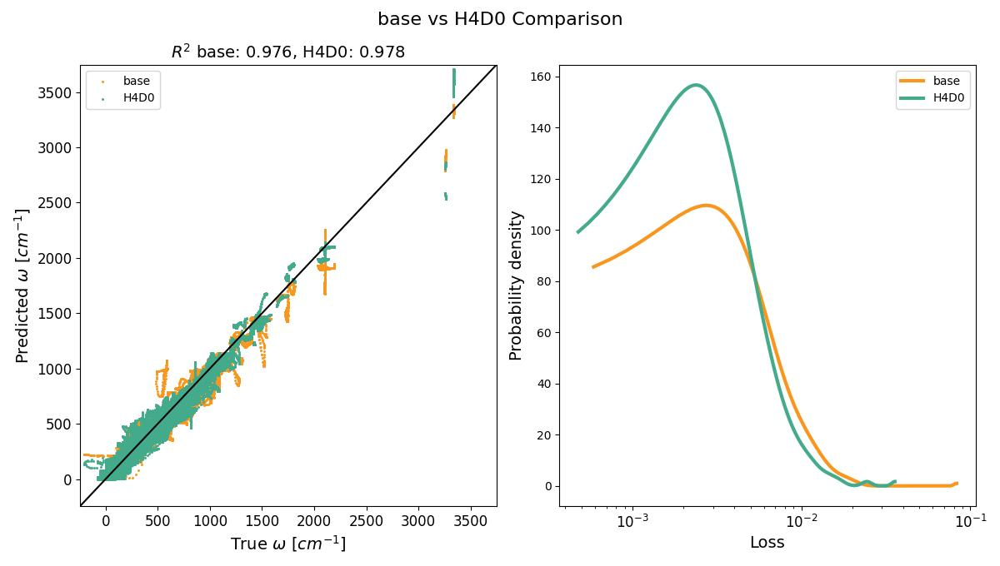
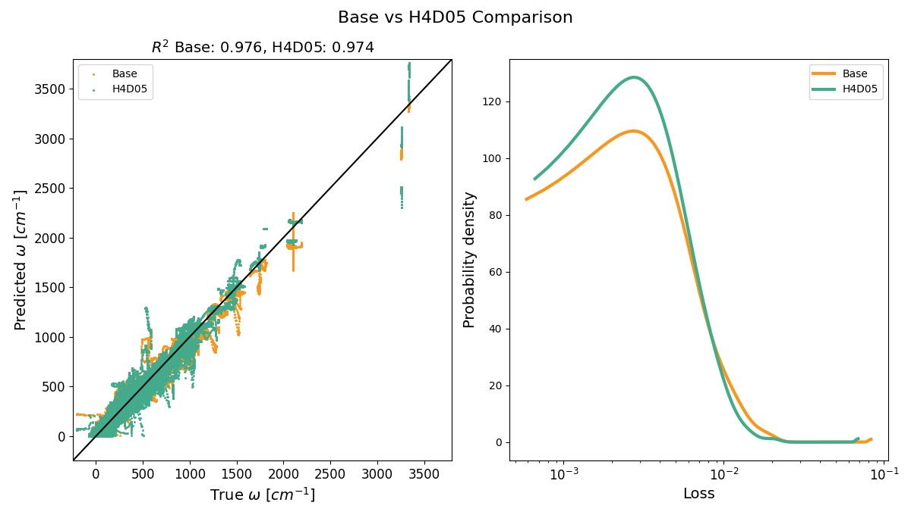
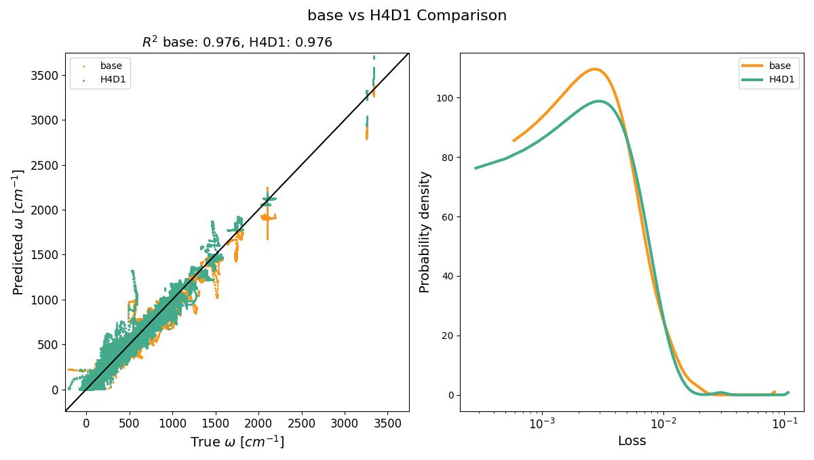
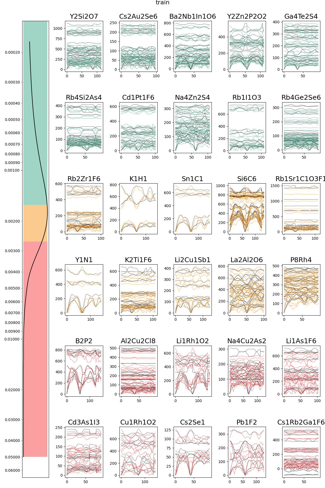
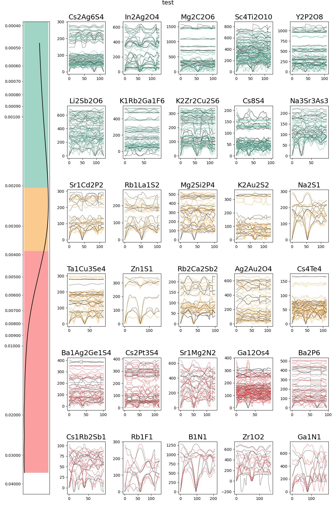
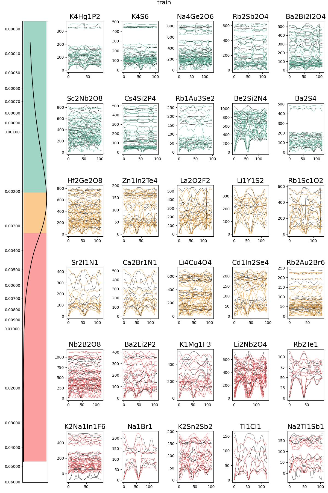
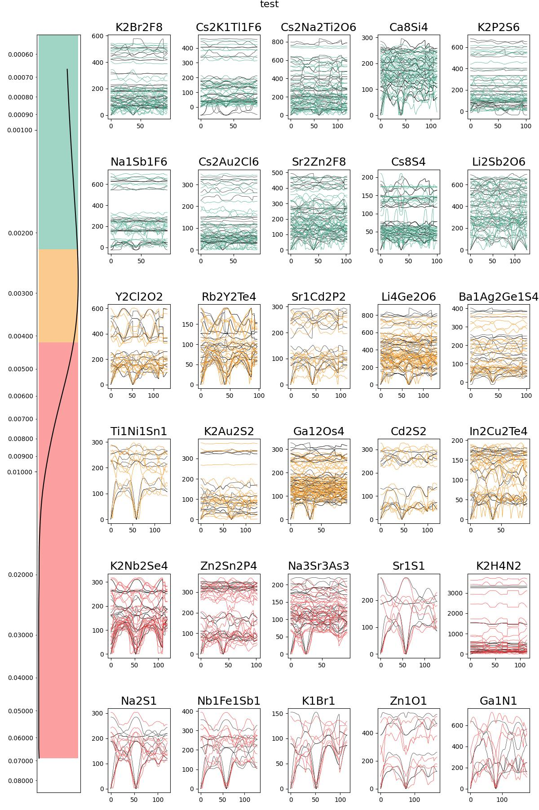
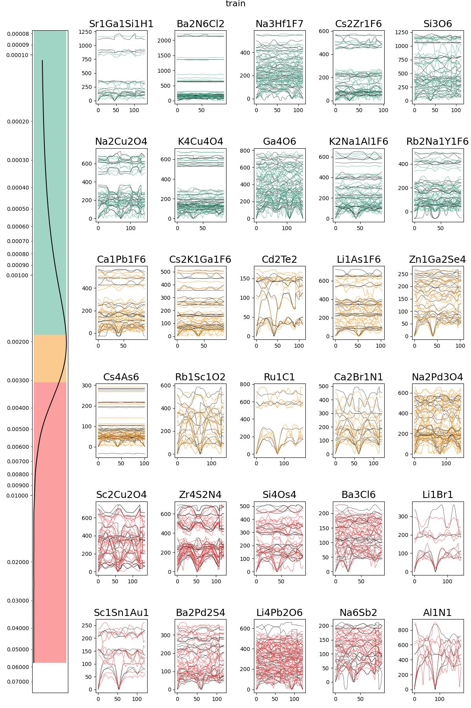
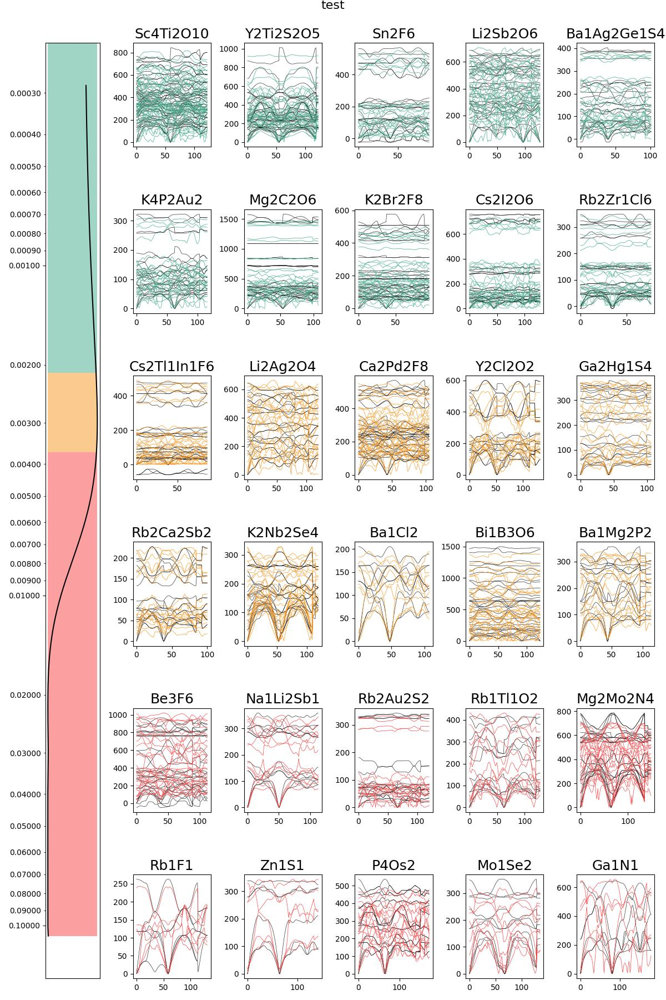

# VGNNA: Virtual Node Graph Neural Network with Attention for Full Phonon Prediction

This repository provides the implementation of the Virtual Node Graph Neural Network with Attention (VGNNA) for full phonon prediction in materials science. VGNNA is designed to address the challenges in phonon prediction using graph neural networks.

## Environment Setup

```bash
# Create virtual environment
conda create -n phonon python=3.9 -y
conda activate phonon

# Install dependencies
pip install uv
uv pip install -r requirements.txt -f https://pytorch-geometric.com/whl/torch-2.0.0+cu118.html
uv pip uninstall numpy
uv pip install "numpy<2.0.0"
```

## Configuration

Edit `configs/train.yaml` to customize training parameters.

Edit `configs/sample.yaml` to customize sampling parameters.

## Training

The Training process takes about 11.5h on a single 4090 GPU for 200 Iterations.

### Basic Usage

```bash
cd VGNNA/src
python train.py
```

### Override Parameters via Command Line

Any parameter in the YAML config can be overridden:

```bash
python train.py --lr 0.01 --max_iter 100
```

## Sampling

### Basic Usage

```bash
cd VGNNA/src
python sample.py
```

### Override Parameters via Command Line

Any parameter in the YAML config can be overridden:

```bash
python sample.py --out_dir ../viz --save_extension png
```

## Experimental Results

We evaluated the performance of k-MVN with and without attention mechanism on the phonon prediction task. The results demonstrate significant improvement when integrating Graph Transformer attention into the k-MVN architecture.

### Dropout Experiments

We conducted experiments to investigate the effect of dropout regularization on the attention-enhanced model. Two configurations were tested:

- **H4D0**: Hidden size = 4, Dropout = 0.0
- **H4D1**: Hidden size = 4, Dropout = 0.1

#### Test Set Performance Comparison

| Model Configuration       | Test Loss  | Improvement over Baseline |
| ------------------------- | ---------- | ------------------------- |
| k-MVN (baseline)          | 0.0047     | -                         |
| k-MVN + Attention + H4D0  | **0.0041** | **12.8%**                 |
| k-MVN + Attention + H4D05 | 0.0044     | 6.4%                      |
| k-MVN + Attention + H4D1  | 0.0045     | 4.3%                      |

#### Key Findings

1. **Best Performance with No Dropout**: The H4D0 configuration (dropout=0.0) achieves the best test loss of 0.0041, representing a **12.8% improvement** over the baseline model.

2. **Impact of Dropout**: Adding dropout (H4D05, dropout=0.05 and H4D1, dropout=0.1) results in a test loss of 0.0044 and 0.0045, which is an about **5.5% improvement** over baseline but **7.3% worse** than H4D0. This indicates that:
   - Dropout has a negative impact on model performance for this task
   - The attention mechanism itself provides sufficient regularization
   - The model benefits from utilizing all available information without dropout

3. **Attention Mechanism Effectiveness**: Both attention-enhanced configurations significantly outperform the baseline (0.0047), confirming the effectiveness of the attention mechanism regardless of dropout setting.

#### Dropout Experiment Visualizations

The following figure provides a comprehensive comparison between the baseline k-MVN model and the attention-enhanced model:

**Baseline vs H4D0 Comparison:**

<p align="center">
  
</p>

**Baseline vs H4D05 Comparison:**

<p align="center">
  
</p>

**Baseline vs H4D1 Comparison:**

<p align="center">
  
</p>

**Baseline Phonon Band Predictions:**

<p align="center">
  
  
</p>

**H4D0 Phonon Band Predictions:**

<p align="center">
  
  
</p>

**H4D05 Phonon Band Predictions:**

<p align="center">
  
  
</p>

**H4D1 Phonon Band Predictions:**

<p align="center">
  
  
</p>

## Reference

- Virtual Node Graph Neural Network for Full Phonon Prediction [Paper](https://arxiv.org/abs/2301.02197) | [Github Code](https://github.com/RyotaroOKabe/phonon_prediction)
- Graph Transformer Networks for Accurate Band Structure Prediction: An End-to-End Approach [Paper](https://arxiv.org/abs/2411.16483) | [Github Code](https://github.com/qmatyanlab/Bandformer)
- **Dataset**: Petretto, Guido; Dwaraknath, Shyam; Miranda, Henrique P. C.; Winston, Donald; Giantomassi, Matteo; Rignanese, Gian-Marco; et al. (2018). High-throughput Density-Functional Perturbation Theory phonons for inorganic materials. figshare. Collection. [Dataset](https://doi.org/10.6084/m9.figshare.5649298)
- **Architecture:** Zhantao Chen, Nina Andrejevic, _et al._ "Virtual Node Graph Neural Network for Full Phonon Prediction." Adv. Sci. 8, 2004214 (2021). [Website](https://onlinelibrary.wiley.com/doi/10.1002/advs.202004214)
- **E(3)NN:** Mario Geiger, Tess Smidt, Alby M., Benjamin Kurt Miller, _et al._ Euclidean neural networks: e3nn (2020) v0.4.2. [Website](https://doi.org/10.5281/zenodo.5292912)
- **seekpath:** Y. Hinuma, G. Pizzi, Y. Kumagai, F. Oba, I. Tanaka, Band structure diagram paths based on crystallography, Comp. Mat. Sci. 128, 140 (2017) [Website](https://seekpath.readthedocs.io/en/latest/index.html)
- **Transformer Implementation**: We referred to [PyTorch's official implementation](https://pytorch.org/docs/stable/generated/torch.nn.Transformer.html) and [The Annotated Transformer](https://nlp.seas.harvard.edu/2018/04/03/attention.html).
- **Open Source Repositories**:
  - [Xtal2DoS](https://github.com/JunwenBai/Xtal2DoS)
  - [e3nn](https://github.com/e3nn/e3nn)
  - [nanoGPT](https://github.com/karpathy/nanoGPT)

## License

MIT License - See LICENSE file for details
